# 项目 6 · AI 结对排障：让模型动手，让闸门留人

> 📍 位置：阶段 4 · 实战篇 · 项目 6 ｜ ⏱ 预计用时：90-120 分钟 ｜ 难度：★★★★☆

> ⬅️ 上一章：[项目 5 · 故障排查 20 例](项目5-故障排查20例.md) ｜ ➡️ 下一章：[01 · 树莓派是什么与选购](../05-raspberry-pi/01-树莓派是什么与选购.md)

前五个项目里，AI 是助手：解释报错、起草脚本。这个项目把它升级成「结对工程师」：它读日志、提假设、写补丁，但真正敲回车的是你。你将为一次真实故障建立完整档案——原始命令、模型假设、人工审阅的 diff、验证证据——并搭好三道安全闸门：只读白名单、沙箱目录、可回滚的 git 流程。做完之后，你会清楚哪些任务可以放心交给模型，哪些必须人来按确认键。

## 🎯 项目目标

1. 能让 AI 代理在**只读模式**下完成现场勘察，每条结论都附命令证据。
2. 能把模型输出拆成「事实」与「假设」，并为每个假设设计最小验证。
3. 能搭好安全闸门：只读白名单、沙箱目录、改前 commit、改后 diff 审阅。
4. 能交付一份 `CASE.md`：第三人拿着它能重走整个排障过程。

## 🧠 方案设计

结对排障固定四段流程，任何一段都不能跳：

```
现场记录 → AI 假设 → 最小验证 → 修复回滚
```

AI 代理的权限走四级台阶，每升一级过一道人工闸门：



完整档案 `CASE.md` 的五个段落，每一段都要能被第三人复核：



**分工边界**：模型擅长解释报错、列假设、起草补丁、整理长日志；人负责按回车、判断业务影响、批准 sudo、决定回滚。模型给的是假设不是结论，验收标准是最初的现象消失，而不是命令跑通。

## 🛠 动手实施

环境：一台可随意折腾的测试机（或 WSL/虚拟机）。终端 AI 代理任选其一：aider、Claude Code、opencode，或直接脚本调用 API。没有网络时，用文末「延伸阅读」里的提示词模板手工走一遍流程，交付物要求不变。

**步骤 1：造一个可控故障。** 把项目 2 的巡检脚本复制进沙箱，故意改坏一处：

```bash
mkdir -p ~/ai-lab && cd ~/ai-lab
cp ~/road-to-linux/scripts/health-report.sh ./check.sh   # 项目 2 的巡检脚本
sed -i 's/ df -h / df -x /' check.sh                     # 非法选项，脚本必挂
git init -q && git add -A && git commit -qm 'broken on purpose'
./check.sh; echo "exit=$?"                               # 亲眼看它失败
```

**步骤 2：只读勘察。** 把代理约束在只读白名单，要求每条结论引用证据：

```bash
# 在代理的配置里限定可执行命令，例如 aider 的 --read-only:
# aider --read-only --message "只读勘察 check.sh 为什么失败，每条结论附命令输出"
```

**步骤 3：要假设。** 要求模型把输出分成两栏：「事实」（附证据）和「推测」（附验证方法）。不允许直接给修复方案。

**步骤 4：最小验证。** 一次只验一个假设，顺序由你定：

```bash
bash -n check.sh        # 假设 A：语法问题？预测：通过
bash -x check.sh        # 假设 B：运行时错误？预测：df 报非法选项
```

**步骤 5：修复过闸。** 让模型出补丁，人审 diff，批准后才应用：

```bash
# 代理产出补丁 → 写入 fix.patch
git diff --no-index /dev/null fix.patch   # 或直接在交互里看 diff
git apply --check fix.patch               # 干跑验证能打上
git apply fix.patch && git add -A && git commit -qm 'ai-patch: reviewed by me'
```

**步骤 6：验收与复盘。** 验收标准是「最初的现象消失」：

```bash
./check.sh; echo "exit=$?"   # 现在应为 0
git revert --no-edit HEAD    # 演练一次回滚，确认能回去
git reset --hard HEAD^       # 复原，保留 ai-patch 提交
```

最后把六步的原始命令、输出、模型假设、diff、验收结果按五段写进 `CASE.md`（模板见「延伸阅读」）。

## 💡 避坑指南

- **贴日志先脱敏**：密钥、内网地址、用户名先入脱敏清单，再贴给任何模型；AI 辅助运维章节的提示词模板默认要求脱敏。
- **别把「应该」当事实**：模型的每个结论都要能落到一条命令输出；落不到，就标成「待验证」而不是采信。
- **别在生产机上开写权限**：先在练习目录授权，跑顺了再谈扩大范围；闸门一旦跳过，档案就失去可信度。
- **别一次给太大目标**：「帮我优化系统」必然翻车；拆成「找出 check.sh 失败的最直接原因」这种可验证的小步。
- **别忘了回滚点**：没有 commit 的改动不算修复，只是许愿；每次应用补丁前确认 `git status` 干净。

## ✍️ 进阶挑战

- 把 `journalctl` 查询包装成只读工具（MCP / 函数调用）接给模型，对比「纯文本贴日志」和「结构化工具」的假设质量。
- 用 sudoers 白名单把代理可执行的命令钉死在 `journalctl`、`systemctl status`、`ls`、`cat` 这一级。
- 同一故障分别问三个模型，比较谁的假设可验证、谁的 diff 更克制。

## 📺 推荐视频

- [YouTube · Ollama 与 Open WebUI](https://www.youtube.com/watch?v=RQFfK7xIL28) — Christian Lempa，39分7秒。AI 工具、日志勘察与脚本实战的背景演示；结对排障流程、安全闸门与 CASE.md 验收以正文为准。
- [B站 · 日志服务原理图](https://www.bilibili.com/video/BV1Sv411r7vd/?p=118) — 韩顺平，P118，4分30秒。AI 工具、日志勘察与脚本实战的背景演示；结对排障流程、安全闸门与 CASE.md 验收以正文为准。
- [B站 · 定时备份数据库（实战）](https://www.bilibili.com/video/BV1Sv411r7vd/?p=106) — 韩顺平，P106，25分27秒。AI 工具、日志勘察与脚本实战的背景演示；结对排障流程、安全闸门与 CASE.md 验收以正文为准。

[](https://www.youtube.com/watch?v=RQFfK7xIL28)

[在学习站查看配套媒体](https://zhuguang-zfg.github.io/linux/#read=docs%2F04-projects%2F%E9%A1%B9%E7%9B%AE6-AI%E7%BB%93%E5%AF%B9%E6%8E%92%E9%9A%9C.md) · [视频资料与核验说明](../../resources/videos.md)。标题、作者和分P已核对，未逐条完成实播，播放限制以原站为准。

## ✅ 验收清单

- [ ] `CASE.md` 五段齐全：现场、假设、验证、修复、复盘，且每段含原始命令与输出。
- [ ] 修复在 git 历史里是一个可 `revert` 的独立提交，作者信息标明了人工审阅。
- [ ] 能说清哪一步最容易出事、闸门设在哪、为什么。
- [ ] 换一台机器（或请同伴）照 `CASE.md` 能重走全程并得到同一结论。

## 🔗 延伸阅读

- [《04-实战篇练习》](../../exercises/04-实战篇练习.md)——配套练习与评分要点。
- [提示词实验室](../../resources/prompt-lab.md)——排障提示词模板与脱敏清单。
- [工具箱](../../resources/toolbox.md)——终端 AI 代理选型与配置要点。
- [阶段 3 · AI 辅助学习与运维](../03-pro/07-AI辅助学习与运维.md)——只读提问与证据核对的理论基础。
- [ROADMAP · AI + Linux 开发支线](../../ROADMAP.md)——本项目的路线图出处与后续弹性周安排。
